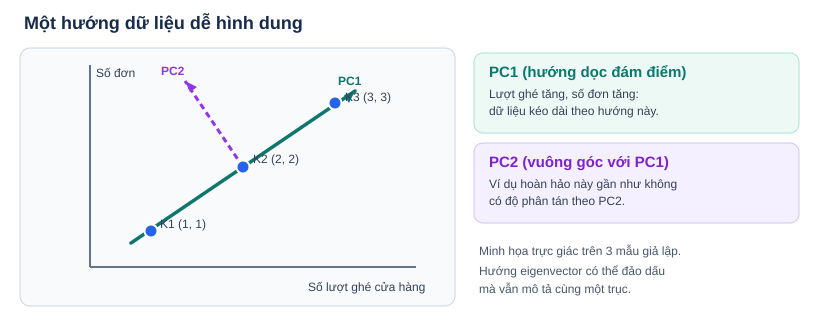
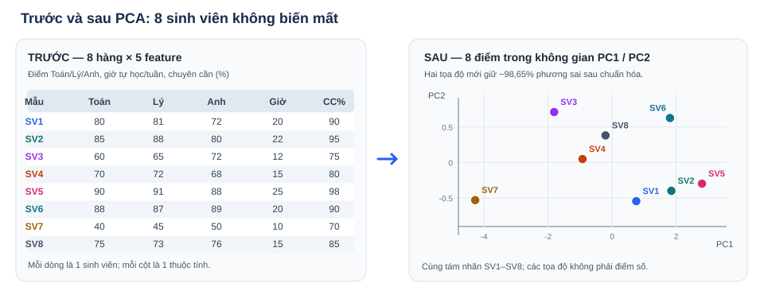

# PCA — Giảm chiều dữ liệu để nhìn rõ vấn đề trong AI

*AI / Data Science · Tài liệu tự học dành cho sinh viên · Phiên bản góp ý 05*

## 1. PCA nằm ở đâu trong chuỗi kiến thức?

**Từ vựng trong mục:** **PCA** — phân tích thành phần chính; **Vector** — véc-tơ; **Matrix** — ma trận; **Feature** — đặc trưng.

```text
Python cơ bản
   ↓
List / Tuple / Dictionary
   ↓
NumPy Array → Vector → Matrix
                          ↓
             Feature và Dataset
                          ↓
                Mean / Variance
                          ↓
          StandardScaler / Covariance
                          ↓
                Eigenvector / Eigenvalue
                          ↓
                  PCA ← BÀI NÀY
                          ↓
     Data Visualization / Clustering / ML Pipeline
                          ↓
            Classification / Prediction
```

**Bạn đang ở đâu?** PCA thuộc giai đoạn **tiền xử lý và biểu diễn dữ liệu (feature transformation)**, sau khi biết làm việc với mảng, vector, ma trận và thống kê mô tả; trước các bài sử dụng dữ liệu để huấn luyện mô hình AI. PCA không tự dự đoán nhãn, phân cụm hay tìm câu trả lời đúng.

**Liên hệ với bài trước:** Một **vector** biểu diễn thông tin của một đối tượng; nhiều vector cùng độ dài xếp thành **matrix**, trong đó mỗi hàng là một đối tượng và mỗi cột là một **feature**. PCA nhận matrix đó và trả về matrix mới có ít cột hơn.

## 2. English vocabulary — Các từ cần nhận biết

| English | Hiểu bằng tiếng Việt | Gặp ở đâu? |
|---|---|---|
| **Sample / Observation** | Một mẫu, một đối tượng được ghi nhận | Mỗi dòng dữ liệu |
| **Feature** | Một đặc trưng mô tả đối tượng | Mỗi cột dữ liệu |
| **Dataset** | Tập dữ liệu | Bảng nhiều dòng và cột |
| **Vector** | Một dãy số biểu diễn một đối tượng | `np.array([80, 85, 90])` |
| **Matrix** | Bảng số hai chiều | `X.shape == (8, 5)` |
| **Mean** | Giá trị trung bình | `X.mean(axis=0)` |
| **Variance** | Độ phân tán của dữ liệu | `np.var(X, axis=0)` |
| **Standardization** | Chuẩn hóa thang đo | `StandardScaler()` |
| **Covariance** | Hai đặc trưng cùng biến thiên thế nào | `np.cov(X, rowvar=False)` |
| **Eigenvector / Eigenvalue** | Hướng chính / lượng biến thiên theo hướng đó | `np.linalg.eigh(...)` |
| **Principal Component (PC)** | Trục dữ liệu mới được PCA tạo ra | `PC1`, `PC2` |
| **Dimensionality Reduction** | Giảm số lượng đặc trưng | `PCA(n_components=2)` |
| **Explained Variance Ratio** | Tỷ lệ biến thiên được mỗi PC giữ lại | `pca.explained_variance_ratio_` |
| **Fit / Transform** | Học quy tắc từ dữ liệu / áp dụng quy tắc đó | `fit()`, `transform()` |
| **Data Leakage** | Dữ liệu kiểm tra bị dùng để học trước | Tránh bằng `Pipeline` |

## 3. Thư viện và hàm Python cần biết trước khi học PCA

**Từ vựng trong mục:** **NumPy** — thư viện tính toán mảng; **scikit-learn** — thư viện học máy; **Keyword argument** — đối số đặt tên.

Cài thư viện:

```bash
python -m pip install numpy scikit-learn matplotlib
```

Các tham số viết dạng `tên=giá_trị` (*keyword arguments — đối số đặt tên*) được giải thích **cùng hàm mà chúng điều khiển**. Khi đến ví dụ, ta chỉ chú thích dữ liệu và **lý do thực hiện từng bước**, tránh giải nghĩa đi giải nghĩa lại mỗi tham số trong code.

### 3.1. NumPy — tạo, kiểm tra và tính trên dữ liệu

| Hàm / cách viết | Công dụng và ý nghĩa tham số | Khi nào cần |
|---|---|---|
| `np.array(data, dtype=float)` | Chuyển dữ liệu thành mảng; `dtype=float` chọn **kiểu số thực**, hỗ trợ giá trị thập phân. Nếu bỏ, NumPy có thể suy ra kiểu nguyên từ dữ liệu nguyên. | Tạo dữ liệu số để tiếp tục tính toán; **không tự chuẩn hóa** |
| `X.shape` | Trả về `(số hàng, số cột)` đối với matrix hai chiều. | Kiểm tra số đối tượng và số feature |
| `np.vstack(vectors)` | Ghép các vector **theo chiều hàng** thành matrix. | Từ nhiều đối tượng → một bảng |
| `X.mean(axis=0)` | `axis=0`: gom các hàng, tính một giá trị trung bình cho **mỗi cột**. Nếu `axis=1` thì tính cho từng hàng. | Tính mean từng feature |
| `X.var(axis=0)` | `axis=0`: tính variance cho từng cột. | Xem độ phân tán của từng feature |
| `np.cov(X, rowvar=False)` | `rowvar=False`: xem **mỗi cột là một biến**, mỗi hàng là một mẫu. Mặc định `rowvar=True` hiểu hàng là biến. | Lập matrix covariance |
| `np.corrcoef(X, rowvar=False)` | Tương tự `rowvar=False`, tính correlation giữa các cột. | Kiểm tra hai kênh có xu hướng biến thiên cùng nhau |
| `np.linalg.eigh(C)` | Lấy eigenvalues (giá trị riêng) và eigenvectors (vector riêng) của matrix đối xứng như covariance. | Hiểu hướng biến thiên của dữ liệu |
| `np.round(values, 2)` | Làm tròn đến hai chữ số thập phân để dễ đọc. | Hiển thị kết quả, không thay đổi dữ liệu gốc nếu chỉ in |

**Ví dụ nhỏ — hai khách hàng, hai feature:**

```python
import numpy as np

# Mỗi HÀNG = một khách; CỘT 0 = lượt ghé (lượt), CỘT 1 = đơn (đơn).
X = np.array([[2, 3], [4, 5]], dtype=float)

# Kiểm tra cấu trúc trước, rồi tính mean (trung bình) theo từng cột.
print("Samples x Features:", X.shape)  # (2, 2)
print("Mean per feature:", X.mean(axis=0))  # [3. 4.]
```

### 3.2. scikit-learn — chuẩn hóa, giảm chiều và ứng dụng AI

| Hàm / cách viết | Công dụng và ý nghĩa tham số | Khi nào cần |
|---|---|---|
| `StandardScaler()` | Học mean và độ lệch chuẩn theo từng feature, để đưa các cột về thang đo có thể so sánh. | Trước PCA khi các cột có đơn vị khác nhau |
| `scaler.fit_transform(X)` | **Fit (học quy tắc)** từ `X` rồi **transform** `X`. | Dữ liệu dùng để học cách chuẩn hóa |
| `scaler.transform(X_new)` | Biến đổi mẫu mới theo quy tắc đã học, **không fit lại**. | Tránh rò rỉ dữ liệu test |
| `PCA(n_components=2)` | `n_components=2` chọn **hai principal components (thành phần chính)** mới. Thay số 2 nếu muốn số chiều khác. | Trực quan hóa trên mặt phẳng |
| `PCA(n_components=1)` | Chỉ giữ **một** thành phần chính. | Thử tóm tắt nhiều kênh đo |
| `PCA(n_components=0.95, svd_solver="full")` | `0.95` nghĩa là giữ **tối thiểu 95% variance**; `svd_solver="full"` dùng phép phân rã đầy đủ, hỗ trợ chọn số PC theo ngưỡng. | Tự chọn số chiều đáp ứng ngưỡng |
| `pca.fit_transform(X)` / `pca.transform(X_new)` | Học các trục PC và chuyển dữ liệu sang trục mới; mẫu mới chỉ cần `transform`. | Biểu diễn dữ liệu trên trục PCA đã học |
| `pca.explained_variance_ratio_` | Tỷ lệ variance mỗi trục PC giữ lại. | Kiểm tra mức biến thiên sau giảm chiều |
| `train_test_split(..., test_size=0.25, stratify=iris.target, random_state=42)` | Dùng **25% làm test**; `stratify` giữ tỷ lệ nhãn loài; `random_state=42` cố định ngẫu nhiên để tái lập (42 không đặc biệt). | Chia tập dữ liệu công bằng trước khi học |
| `Pipeline([...])` | Ghép các bước xử lý liên tiếp; gọi `fit` trên train để tránh leakage (rò rỉ dữ liệu). | So sánh mô hình dự đoán có/không có PCA |
| `KMeans(n_clusters=2, random_state=42, n_init=10)` | Thử chia **2 nhóm**; `random_state` giúp tái lập; `n_init=10` thử mười lần chọn tâm ban đầu. | **Phần mở rộng:** clustering |
| `LogisticRegression(max_iter=1000)` | Mô hình classification; `max_iter` cho phép tối đa 1000 lượt tối ưu, không buộc chạy đủ 1000. | **Phần mở rộng:** dự đoán nhãn |
| `enumerate(items, start=1)` | `start=1` đếm từ 1 thay vì 0. | Đặt nhãn SV1, SV2... |
| `plt.annotate(..., xytext=(4,4), textcoords="offset points")` | Dời vị trí chữ chú thích tương đối 4 point theo hai hướng để không đè điểm vẽ. | Hiển thị biểu đồ rõ ràng |

**Điểm cần nhớ:** Tên hàm và các tham số đã được giải thích ở đây. Trong code minh họa phía dưới, comment chỉ tập trung vào: **dữ liệu chứa gì, vì sao làm bước đó và kết quả cần kiểm tra gì**.

## 4. PCA và các khái niệm liên quan

**Từ vựng trong mục:** **PCA** — phân tích thành phần chính; **Feature** — đặc trưng; **PC** — thành phần chính.

Phần này đi theo đúng thứ tự: **giải thích bằng lời → ví dụ nhỏ → Python thực hiện phép tính → đọc kết quả**. Mỗi khái niệm là một mắt xích để hiểu PCA, không phải một chủ đề toán học tách rời.

### 4.1. Vì sao có lúc phải giảm số thông tin?

**Từ vựng trong mục:** **PCA** — phân tích thành phần chính; **Feature** — đặc trưng; **Dimensionality reduction** — giảm chiều dữ liệu.

Một cửa hàng lưu rất nhiều thông tin về khách: số lần ghé xem, số đơn, số tiền đã chi, thời gian xem hàng, số lần quay lại… Khi dữ liệu có quá nhiều cột, chúng ta khó vẽ, khó nhìn sự khác nhau giữa các khách và đôi khi phải xử lý nhiều giá trị có xu hướng giống nhau.

**PCA** (Principal Component Analysis) tạo ra một bộ cột số **mới** để tóm tắt sự biến thiên trong các cột ban đầu. Thay vì cố chọn hai cột cũ, PCA có thể kết hợp thông tin từ nhiều cột để tạo hai tọa độ mới, phục vụ quan sát hoặc làm đầu vào cho các bước xử lý tiếp theo.

**Lưu ý quan trọng:** PCA không dự đoán ai sẽ mua hàng và không tự phân loại khách. Giữ 95% phương sai **không có nghĩa** mô hình AI dự đoán đúng 95%.

### 4.2. Feature, Vector, Matrix

**Từ vựng trong mục:** **Feature** — đặc trưng; **Vector** — véc-tơ; **Matrix** — ma trận; **Shape** — kích thước mảng.

**Nhắc lại các khái niệm có liên quan**

- **Feature:** Một thuộc tính mô tả đối tượng. Ví dụ, số đơn hàng là một feature của khách hàng; tổng chi tiêu là một feature khác.
- **Vector:** Dãy giá trị mô tả **một** đối tượng, trong đó mỗi vị trí tương ứng với một feature theo thứ tự đã quy định.
- **Matrix:** Bảng hai chiều gồm **nhiều vector**. Trong ví dụ này, **mỗi hàng là một khách hàng**, còn **mỗi cột là một feature**. Vì vậy, số hàng cho biết số khách, số cột cho biết số đặc trưng.

**Ví dụ nhỏ: từ 5 khách hàng → 5 vector → 1 ma trận**

Một cửa hàng cần thống kê hành vi của **5 khách hàng giả lập**. Với mỗi khách, hệ thống ghi đúng 5 thông tin theo thứ tự sau:

| Vị trí / Cột | Feature | Ý nghĩa / đơn vị |
|---|---|---|
| 0 | Visits | Số lượt vào cửa hàng (lượt) |
| 1 | Orders | Số đơn đã đặt (đơn) |
| 2 | Spending | Tổng chi tiêu (**nghìn đồng**) |
| 3 | ViewingMinutes | Thời gian xem sản phẩm (phút) |
| 4 | ReturnVisits | Số lượt quay lại cửa hàng (lượt) |

Ta sẽ làm tuần tự: **(1)** tạo các vector của từng khách, **(2)** ghép vector thành một matrix, **(3)** xem một hàng và một cột, **(4)** hiểu ý nghĩa của `shape`.

```python
import numpy as np

# BƯỚC 1 — Mỗi khách hàng có một véc-tơ chứa 5 đặc trưng.
# Thứ tự 5 cột: [lượt ghé, số đơn, chi tiêu (nghìn đồng),
#               số phút xem hàng, số lượt quay lại].
customer_1 = np.array([12, 4, 950, 18, 7])    # Khách 1
customer_2 = np.array([15, 5, 1200, 22, 9])   # Khách 2
customer_3 = np.array([8, 2, 500, 10, 3])     # Khách 3
customer_4 = np.array([21, 7, 1600, 26, 11])  # Khách 4
customer_5 = np.array([6, 1, 220, 5, 1])      # Khách 5

# BƯỚC 2 — Ghép 5 véc-tơ theo chiều hàng bằng np.vstack().
# Mỗi véc-tơ trở thành một hàng; không thay đổi thứ tự đặc trưng.
customer_vectors = [
    customer_1, customer_2, customer_3, customer_4, customer_5
]
X = np.vstack(customer_vectors)

# BƯỚC 3 — Đọc một hàng và một cột để hiểu cấu trúc dữ liệu.
print("Khách hàng đầu tiên:", X[0])  # 5 feature của khách 1
print("Chi tiêu 5 khách:", X[:, 2])  # [950 1200 500 1600 220]

# BƯỚC 4 — Số hàng × số cột = số khách × số đặc trưng.
print("Số vector:", len(customer_vectors))  # 5
print("Shape:", X.shape)  # (5, 5)
```

**Đọc kết quả từng bước:**

1. **5 khách → 5 vector:** Mỗi `customer_i` chứa 5 số, tương ứng 5 đặc trưng của một khách.
2. **5 vector → 1 matrix:** `np.vstack()` ghép các vector thành bảng `X` có 5 hàng.
3. **Lấy một hàng:** `X[0]` trả lại đủ 5 thông tin của khách đầu tiên; **lấy một cột:** `X[:, 2]` trả về chi tiêu của cả 5 khách.
4. **Kiểm tra `shape`:** `(5, 5)` nghĩa là **5 khách hàng và 5 đặc trưng**, không phải 25 khách hàng.

**Nối với PCA:** Nếu sau này cửa hàng có **100 khách × 5 feature**, shape là `(100, 5)`. PCA giảm còn hai thành phần chính sẽ cho bảng mới có shape `(100, 2)`: **vẫn 100 khách**, nhưng mỗi khách được biểu diễn bằng **2 tọa độ tổng hợp PC1/PC2**, không phải chọn lại nguyên hai cột gốc. Bảng dữ liệu gốc vẫn cần được lưu nếu muốn xem thông tin chi tiết như số đơn hay chi tiêu.

**Tự kiểm tra nhanh — 4.2:** Một cửa hàng có 20 khách, mỗi khách có 6 feature. Ma trận có shape nào? `X[:, 2]` lấy gì?

**Đáp án gợi ý:** `(20, 6)`; `X[:, 2]` lấy **toàn bộ 20 giá trị của feature ở cột thứ ba** (Python đếm cột từ 0).

### 4.3. Mean, Variance, Standardization

**Từ vựng trong mục:** **Mean** — trung bình; **Variance** — phương sai; **Standardization** — chuẩn hóa; **StandardScaler** — bộ chuẩn hóa dữ liệu.

**Nhắc lại kiến thức liên quan:** Ở mục 4.2, mỗi **hàng** là một khách hàng và mỗi **cột** là một feature. Vì một cột có thể có giá trị lớn hơn cột khác do đơn vị đo, chúng ta cần biết **Mean** (giá trị trung bình), **Variance** (độ phân tán) trước khi dùng **StandardScaler** để các cột có thể được so sánh hợp lý.

**Mean** là trung bình của một cột, giúp biết giá trị thường gặp. **Variance** là mức độ các giá trị trong cột phân tán quanh trung bình: nếu mọi khách chi gần bằng nhau, phương sai chi tiêu sẽ nhỏ; nếu có khách chi rất ít và khách chi rất nhiều, phương sai lớn.

**Standardization** là đưa những cột dùng thang đo khác nhau về mức có thể so sánh. Ví dụ số đơn thường chỉ vài đơn, nhưng chi tiêu lại hàng trăm hoặc hàng nghìn. Nếu không xem xét đơn vị, một cột có số lớn có thể chi phối PCA chỉ do cách ghi số. `StandardScaler` tính trung bình và độ lệch chuẩn của từng cột rồi thực hiện phép tính tương đương **(giá trị − trung bình cột) / độ lệch chuẩn cột**.

**Ví dụ nhỏ — ba khách với hai thông tin:**

```python
import numpy as np
from sklearn.preprocessing import StandardScaler

# BƯỚC 1 — Lập bảng 3 khách hàng giả lập từ 3 véc-tơ.
# Mỗi hàng = 1 khách: K1, K2, K3.
# Cột 0 = Orders (đơn); cột 1 = Spending (nghìn đồng).
X = np.array([
    [1, 100],  # K1: 1 đơn, 100 nghìn đồng
    [2, 200],  # K2: 2 đơn, 200 nghìn đồng
    [3, 300],  # K3: 3 đơn, 300 nghìn đồng
], dtype=float)

# BƯỚC 2 — axis=0 tính mean/variance theo từng cột cho mọi khách.
print("Mean:", X.mean(axis=0))  # [  2. 200.]
print("Variance:", X.var(axis=0))  # [6.666... 6666.666...]

# BƯỚC 3 — Hai cột có đơn vị rất khác nhau nên thử chuẩn hóa trước PCA.
scaled = StandardScaler().fit_transform(X)
print("Scaled mean:", np.round(scaled.mean(axis=0), 5))  # [0. 0.]
print("Scaled variance:", np.round(scaled.var(axis=0), 5))  # [1. 1.]
```

**Đọc kết quả:** Hai cột vẫn mô tả ba khách, nhưng giá trị đã được đổi sang thang đo chuẩn. Không phải dữ liệu nào cũng bắt buộc chuẩn hóa; hãy xét ý nghĩa đơn vị và mục tiêu phân tích.

**Tự kiểm tra nhanh — 4.3:** Vì sao không nên đưa trực tiếp hai cột `Orders` (đơn) và `Spending` (nghìn đồng) vào PCA mà không xem xét đơn vị?

**Đáp án gợi ý:** Cột chi tiêu có thể có phương sai số học lớn hơn **chỉ vì thang đo**, khiến PCA chú trọng cột đó quá mức. Ta cân nhắc `StandardScaler` để so sánh đặc trưng hợp lý hơn.

### 4.4. Covariance, Eigenvector, Eigenvalue

**Từ vựng trong mục:** **Covariance** — hiệp phương sai; **Eigenvector** — vector riêng; **Eigenvalue** — giá trị riêng.

**Nhắc lại kiến thức liên quan:** Một **matrix** lưu nhiều mẫu theo hàng và feature theo cột. **Variance** đo sự phân tán của *một* cột; **Covariance** giúp xem *hai* cột thay đổi cùng nhau ra sao. Từ matrix hiệp phương sai, ta tìm các **hướng biến thiên** (Eigenvector) và mức biến thiên theo mỗi hướng (Eigenvalue) — đây là những gì PCA sử dụng khi tạo đặc trưng mới.

**Covariance** giúp mô tả *hai feature có xu hướng thay đổi cùng nhau hay không*. Ví dụ, nếu khách ghé cửa hàng nhiều hơn và số đơn hàng cũng thường tăng, hai cột có thể có hiệp phương sai dương. Khi một cột tăng mà cột kia thường giảm, hiệp phương sai có thể âm. Gần 0 có nghĩa ít biến thiên **tuyến tính cùng nhau**, không khẳng định các biến hoàn toàn không liên quan.

**Eigenvector** trong bối cảnh PCA có thể hình dung là một **hướng mới** mà dữ liệu trải dài theo đó. **Eigenvalue** cho biết **mức phương sai** của dữ liệu theo hướng riêng tương ứng. PCA ưu tiên hướng có eigenvalue lớn để giữ lại mức biến thiên đáng kể. Không cần tự giải phương trình ma trận trong bài này vì NumPy có hàm tính sẵn.

**Hình dung đời thường:** Tưởng tượng chấm mỗi khách hàng lên một biểu đồ: trục ngang là **số lần ghé**, trục dọc là **số đơn hàng**. Nếu người ghé nhiều thường mua nhiều, các điểm sẽ tạo thành một đám kéo dài theo hướng chéo lên. Khi đó:

- **Hướng dài của đám điểm** giống trực giác về `PC1`: hướng giữ nhiều sự thay đổi nhất.
- **Hướng vuông góc** là `PC2`: nếu ba điểm nằm đúng trên một đường thẳng, theo hướng này gần như không có sự khác nhau.
- Với ma trận hiệp phương sai, **eigenvector** mô tả các hướng đó; **eigenvalue** mô tả lượng phương sai theo từng hướng. Không cần chứng minh công thức để biết chúng đang giúp PCA làm gì.



*Đây là sơ đồ trực giác từ ba khách giả lập, không phải hình vẽ tự động lấy từ dữ liệu sinh viên ở phần sau. Hướng của vector riêng có thể đổi dấu mà vẫn biểu diễn cùng một trục.*

**Ví dụ nhỏ — lượt ghé và đơn hàng tăng cùng nhau:**

```python
import numpy as np

# BƯỚC 1 — Ba khách giả lập, mỗi hàng tương ứng một khách.
# Cột 0 = lượt ghé cửa hàng (lượt), cột 1 = số đơn (đơn).
# Hai cột tăng cùng nhau trong ví dụ để quan sát hiệp phương sai.
X = np.array([
    [1, 1],  # K1: 1 lượt, 1 đơn
    [2, 2],  # K2: 2 lượt, 2 đơn
    [3, 3],  # K3: 3 lượt, 3 đơn
], dtype=float)

covariance = np.cov(X, rowvar=False)

# BƯỚC 3 — hiệp phương sai là ma trận đối xứng nên dùng eigh.
# eigh dùng cho ma trận đối xứng như hiệp phương sai (khác eig tổng quát).
eigenvalues, eigenvectors = np.linalg.eigh(covariance)

print("Covariance:", covariance)
print("Eigenvalues:", np.round(eigenvalues, 2))  # [0. 2.]
print("Direction count:", eigenvectors.shape[1])  # 2
```

**Đọc kết quả:** Một hướng có phương sai lớn hơn, hướng kia gần như không có phương sai vì hai feature giống nhau trong ví dụ. PCA có thể tận dụng sự trùng lặp tuyến tính này để giảm chiều. Không dùng kết luận này để xóa dữ liệu đo lường quan trọng trong hệ thống thực.

**Tự kiểm tra nhanh — 4.4:** Nếu hai feature luôn tăng cùng nhau, PCA thường cần hướng nào để giữ phần lớn phương sai? `np.linalg.eigh` trả về thông tin gì?

**Đáp án gợi ý:** Hướng đi **dọc theo đám điểm** thường giữ nhiều phương sai. `np.linalg.eigh` trả về **eigenvalues** (mức phương sai theo hướng) và **eigenvectors** (các hướng) của ma trận đối xứng đầu vào.

### 4.5. Principal Component (PC1, PC2) và tỷ lệ phương sai giữ lại

**Từ vựng trong mục:** **Principal Component** — thành phần chính; **Explained Variance Ratio** — tỷ lệ phương sai được giải thích; **PCA** — phân tích thành phần chính.

**Nhắc lại kiến thức liên quan:** Ta đã có dữ liệu dạng **matrix**, mỗi hàng là một mẫu, mỗi cột là một **feature**; thường dùng **StandardScaler** nếu các cột khác thang đo. **Eigenvector** cho một hướng mới, còn **Eigenvalue** gắn với phương sai dọc hướng ấy. PCA tạo các **Principal Component** từ các hướng này; nhờ đó có thể giảm số cột của matrix mà vẫn giữ nhiều biến thiên.

**Principal Component (PC)** là **đặc trưng mới** do PCA tạo từ các đặc trưng cũ. **PC1** giữ lượng phương sai lớn nhất, **PC2** giữ lượng phương sai lớn nhất còn lại theo hướng vuông góc với PC1. Hai cột `PC1`, `PC2` không trùng với hai cột gốc.

**Explained variance ratio (tỷ lệ phương sai được giải thích)** là tỷ lệ phương sai được một PC giữ lại. Nếu hai PC cộng lại được 98%, điều đó chỉ nói rằng hai hướng mới giữ khoảng 98% **mức biến thiên** trên dữ liệu dùng để học PCA, không phải mô hình đúng 98%.

**Ví dụ nhỏ — rút năm thông tin sinh viên còn hai tọa độ:**

```python
import numpy as np
from sklearn.preprocessing import StandardScaler
from sklearn.decomposition import PCA

# BƯỚC 1 — 8 hồ sơ sinh viên giả lập: mỗi HÀNG là 1 sinh viên (SV1..SV8).
# Mỗi véc-tơ/hàng chứa 5 đặc trưng theo thứ tự các CỘT:
# 0 = điểm Toán (0-100); 1 = điểm Vật lý (0-100);
# 2 = điểm Tiếng Anh (0-100); 3 = giờ tự học (giờ/tuần);
# 4 = chuyên cần (phần trăm, 0-100).
X = np.array([
    [80, 81, 72, 20, 90],  # SV1
    [85, 88, 80, 22, 95],  # SV2
    [60, 65, 72, 12, 75],  # SV3
    [70, 72, 68, 15, 80],  # SV4
    [90, 91, 88, 25, 98],  # SV5
    [88, 87, 89, 20, 90],  # SV6
    [40, 45, 50, 10, 70],  # SV7
    [75, 73, 76, 15, 85],  # SV8
], dtype=float)
print("Số sinh viên × số feature:", X.shape)  # (8, 5)

# BƯỚC 2 — Chuẩn hóa 5 cột vì điểm, giờ học và phần trăm khác đơn vị.
scaled = StandardScaler().fit_transform(X)

# BƯỚC 3 — Cần xem dữ liệu trên đồ thị phẳng nên giữ hai tọa độ PC.
pca = PCA(n_components=2)
X_new = pca.fit_transform(scaled)

print("Before:", X.shape)  # (8, 5)
print("After:", X_new.shape)  # (8, 2)
print("Retained (%):", round(pca.explained_variance_ratio_.sum() * 100, 2))

# In tọa độ mới của 3 sinh viên đầu tiên để thấy PC là số cụ thể.
for index, (pc1, pc2) in enumerate(X_new[:3], start=1):
    print(f"SV{index}: PC1={pc1:.2f}; PC2={pc2:.2f}")
```

**Nhìn tận mắt dữ liệu trước và sau**



*Hình được dựng từ chính 8 sinh viên giả lập trong đoạn Python ở trên, sau `StandardScaler` và `PCA(n_components=2)`. Bảng bên trái là **5 cột số gốc**; hình bên phải là **2 tọa độ PC mới**. Mỗi nhãn SV1–SV8 vẫn đại diện cho đúng một sinh viên.*

| Sinh viên | Một vài feature **ban đầu** | PC1 sau PCA | PC2 sau PCA |
|---|---|---:|---:|
| SV1 | Toán 80, Lý 81, Anh 72, tự học 20 giờ, chuyên cần 90% | 0.75 | -0.54 |
| SV2 | Toán 85, Lý 88, Anh 80, tự học 22 giờ, chuyên cần 95% | 1.85 | -0.40 |
| SV3 | Toán 60, Lý 65, Anh 72, tự học 12 giờ, chuyên cần 75% | -1.81 | 0.71 |

**Đọc bảng:** Các giá trị `PC1`/`PC2` là **tọa độ mới**, không phải điểm Toán, điểm Anh hay phần trăm chuyên cần. PCA chỉ đổi cách **biểu diễn** 8 sinh viên; không xác định sinh viên tốt/xấu. Dấu `+`/`-` của các PC có thể đảo giữa các thuật toán/phiên bản mà ý nghĩa giảm chiều vẫn tương đương.

**Vì sao chỉ có hai trục trên hình?** Với bộ dữ liệu này, PC1 giữ khoảng **93,99% phương sai**, PC2 thêm khoảng **4,67%**; tổng khoảng **98,65%**. Hai tọa độ thuận tiện để trực quan hóa, nhưng **không giữ nguyên từng feature ban đầu**.

**Đọc kết quả:** Vẫn có **8 sinh viên** nhưng mỗi người có **2 tọa độ PC**, thay cho năm thông tin ban đầu trong bảng biểu diễn mới. Trên dữ liệu minh họa, tỷ lệ phương sai giữ lại khoảng **98,65%**. Đây không phải thước đo chất lượng học tập của sinh viên.

**Tự kiểm tra nhanh — 4.5:** Nếu có 8 sinh viên × 5 feature, sau PCA còn 2 PC, bao nhiêu sinh viên được giữ lại? Nếu giữ 98,65% phương sai thì AI có tự đạt 98,65% accuracy không?

**Đáp án gợi ý:** Vẫn **8 sinh viên**, vì số hàng không đổi; không, phương sai và độ chính xác dự đoán là hai thước đo khác nhau.

### 4.6. Fit, Transform và Data Leakage

**Từ vựng trong mục:** **Fit** — học quy tắc; **Transform** — biến đổi; **Data Leakage** — rò rỉ dữ liệu; **Train/Test** — huấn luyện/kiểm tra.

**Nhắc lại kiến thức liên quan:** Các feature ban đầu có thể cần **chuẩn hóa** rồi được PCA biến thành các cột **PC**. Muốn áp dụng đúng cho khách hàng mới, ta không học lại toàn bộ quy tắc mỗi lần; cần phân biệt **Fit (học quy tắc)** (học thông số từ dữ liệu hiện có) và **Transform (biến đổi)** (áp dụng thông số đã học). Với mô hình AI, việc dùng tập kiểm tra để học thông số sẽ tạo **Data Leakage**.

**Fit (học quy tắc)** là bước để một bộ xử lý học các thông số từ dữ liệu đầu vào. Với `StandardScaler`, đó là trung bình và độ lệch chuẩn; với `PCA`, đó là các hướng PC. **Transform (biến đổi)** là bước áp dụng những thông số đã học lên dữ liệu cần xử lý.

Khi xây dựng AI, dữ liệu **train** dùng để học, còn dữ liệu **test** để kiểm tra mô hình trên mẫu chưa thấy. Nếu để scaler hoặc PCA học cả dữ liệu test trước khi đánh giá, ta tạo **data leakage**: thông tin đáng ra phải giữ lại cho lúc kiểm tra đã lọt vào quá trình học.

**Ví dụ nhỏ — áp dụng cùng quy tắc cho khách mới:**

```python
import numpy as np
from sklearn.preprocessing import StandardScaler

# BƯỚC 1 — Ba khách huấn luyện (K1..K3); mỗi hàng là một khách.
# Cột 0 = số đơn (đơn); cột 1 = chi tiêu (nghìn đồng).
train = np.array([
    [1, 100],  # K1
    [2, 200],  # K2
    [3, 300],  # K3
], dtype=float)

# BƯỚC 2 — Một khách mới K4, cùng đúng hai cột và đơn vị.
# Không học lại quy tắc chỉ từ một khách mới vì muốn áp dụng quy tắc cũ.
new_customer = np.array([[4, 350]], dtype=float)

scaler = StandardScaler()
scaler.fit(train)                      # BƯỚC 3 — Học chỉ từ 3 khách train
new_scaled = scaler.transform(new_customer)  # BƯỚC 4 — Áp dụng cho K4

print("New shape:", new_scaled.shape)  # (1, 2)
```

**Khi sử dụng PCA để đánh giá mô hình dự đoán**, hãy đặt `StandardScaler` và `PCA` trong `Pipeline` rồi gọi `fit` trên tập train. Trình tự đầy đủ được minh họa ở tình huống 5.

**Tự kiểm tra nhanh — 4.6:** Khi có `X_train` và `X_test`, scaler/PCA được `fit` trên tập nào? Vì sao không `fit` lại trên test?

**Đáp án gợi ý:** Chỉ `fit` scaler và PCA trên **train**, rồi `transform` test bằng quy tắc đã học, để tránh **data leakage** và giữ đánh giá khách quan.

## 5. Năm tình huống lập trình trong thực tế

**Từ vựng trong mục:** **PCA** — phân tích thành phần chính; **Feature** — đặc trưng; **Pipeline** — chuỗi xử lý.

Mỗi tình huống đều gồm: **vấn đề → nhắc lại các khái niệm cần dùng → vì sao chọn cách giải → quy trình → mô tả dữ liệu (từng hàng/cột/đơn vị) → code có ghi từng bước → kiểm tra kết quả**. Trừ Iris là bộ dữ liệu có sẵn, các bảng dữ liệu còn lại đều là **ví dụ giả lập để học cách xử lý**, không phải hồ sơ người hay doanh nghiệp thật.

**Cách học nhẹ nhàng:** Tình huống 1, 2, 4 tập trung trực tiếp vào PCA và cách đọc dữ liệu. **Tình huống 3 (KMeans) và 5 (LogisticRegression/Pipeline) là phần mở rộng**, cho thấy PCA kết hợp với thuật toán AI khác như thế nào. Nếu chưa học phân cụm hoặc phân loại, bạn vẫn có thể đọc ý tưởng và bỏ qua phần chi tiết thuật toán rồi quay lại sau; chúng **không phải kiến thức bắt buộc để hiểu PCA**.

### Tình huống 1 — Phòng đào tạo muốn nhìn tổng quan hồ sơ học tập

**Từ vựng trong mục:** **Feature** — đặc trưng; **StandardScaler** — bộ chuẩn hóa dữ liệu; **PCA** — phân tích thành phần chính.

**Vấn đề:** Bộ phận hỗ trợ sinh viên lưu 5 thông tin cho mỗi người: điểm Toán, Vật lý, tiếng Anh, giờ tự học, chuyên cần. Năm cột làm biểu đồ khó nhìn. Cần một sơ đồ 2D để khám phá các nhóm hồ sơ tương tự, **không tự động chấm điểm hay quyết định ai học yếu**.

**Chọn khái niệm:** Matrix, StandardScaler, PCA, explained variance (phương sai được giải thích), scatter plot.

**Vì sao chọn cách này?** Mục tiêu của phòng đào tạo là **nhìn** sự phân bố hồ sơ trên một biểu đồ, chưa phải dự đoán kết quả học tập. Vì có 5 thông tin nên không thể đặt trực tiếp tất cả trên hai trục; PCA phù hợp để tạo hai tọa độ tổng hợp. Chọn `StandardScaler` vì giờ học và điểm số có đơn vị khác nhau. Ta **kiểm tra phương sai giữ lại trước khi diễn giải hình vẽ**, bởi bản đồ 2D có thể bỏ mất khác biệt quan trọng. Nếu cần đánh giá kết quả học tập thật, phải xây dựng và kiểm định một mô hình khác, không dựa riêng vào PCA.

**Nhắc lại kiến thức để giải bài:** Mỗi sinh viên là **một vector**, 8 vector tạo thành một **matrix** 8 hàng × 5 feature; **StandardScaler** chuẩn hóa đơn vị, còn **PCA** tạo hai tọa độ để vẽ mà vẫn giữ 8 sinh viên.

**Dữ liệu sử dụng:** 8 hồ sơ minh họa, mỗi hàng là một sinh viên. Năm cột lần lượt là điểm Toán, điểm Vật lý, điểm Tiếng Anh (thang 0–100), giờ tự học (giờ/tuần) và tỷ lệ chuyên cần (%).

**Quy trình:** Chuẩn bị bảng 8 × 5 → chuẩn hóa các thang đo → PCA giữ hai trục → kiểm tra phương sai → vẽ từng hồ sơ sinh viên lên 2D.

```python
import numpy as np
import matplotlib.pyplot as plt
from sklearn.preprocessing import StandardScaler
from sklearn.decomposition import PCA

# BƯỚC 1 — Thu thập 8 hồ sơ sinh viên GIẢ LẬP.
# Mỗi HÀNG = một sinh viên (SV1..SV8) = một véc-tơ có 5 giá trị.
# Các CỘT theo thứ tự:
# [0] Math: điểm Toán /100; [1] Physics: điểm Vật lý /100;
# [2] English: điểm Tiếng Anh /100; [3] StudyHours: giờ tự học/tuần;
# [4] Attendance: tỷ lệ chuyên cần (%).
# Cần đúng thứ tự cột cho mọi SV để PCA hiểu đúng đặc trưng.
profiles = np.array([
    [80, 81, 72, 20, 90],  # SV1
    [85, 88, 80, 22, 95],  # SV2
    [60, 65, 72, 12, 75],  # SV3
    [70, 72, 68, 15, 80],  # SV4
    [90, 91, 88, 25, 98],  # SV5
    [88, 87, 89, 20, 90],  # SV6
    [40, 45, 50, 10, 70],  # SV7
    [75, 73, 76, 15, 85],  # SV8
], dtype=float)
print("Bảng hồ sơ sinh viên:", profiles.shape)  # (8, 5)

# BƯỚC 2 — Vì điểm số, giờ học và chuyên cần dùng thang khác nhau,
# cần đưa các cột về thang đo so sánh được trước PCA.
scaled = StandardScaler().fit_transform(profiles)

# BƯỚC 3 — Muốn vẽ trên mặt phẳng nên chọn hai trục PC,
# không phải chỉ lấy hai cột đặc trưng gốc.
pca = PCA(n_components=2)
map_2d = pca.fit_transform(scaled)

# BƯỚC 4 — Kiểm tra xem khi chuyển từ 5 cột sang 2 cột
# ta giữ bao nhiêu phương sai và giữ nguyên 8 hàng.
print("New shape:", map_2d.shape)
print("Retained (%):", round(100 * pca.explained_variance_ratio_.sum(), 2))

plt.scatter(map_2d[:, 0], map_2d[:, 1])
for index, (x, y) in enumerate(map_2d, start=1):
    # Chú thích bằng nhãn ẩn danh; không sử dụng dữ liệu cá nhân thật.
    plt.annotate(f"SV{index}", (x, y), xytext=(4, 4), textcoords="offset points")
plt.xlabel("PC1")
plt.ylabel("PC2")
plt.title("Student profiles after PCA")
plt.grid(alpha=0.3)
plt.show()
```

**Kiểm tra:** shape `(8, 2)`, tổng phương sai giữ lại khoảng **98.65%**. Các điểm gần nhau *trong mặt phẳng PCA* có hồ sơ tương tự theo phép biến đổi đang dùng; điều này không tự động chứng minh họ giống nhau về năng lực thực tế.

### Tình huống 2 — Nhà máy có cảm biến đo thông tin gần như trùng lặp

**Từ vựng trong mục:** **Correlation** — tương quan; **Sensor** — cảm biến; **PCA** — phân tích thành phần chính.

**Vấn đề:** Máy móc có 3 kênh cảm biến cùng đo tải hệ thống theo cách khác nhau. Kỹ sư muốn khám phá liệu tín hiệu có thể biểu diễn gọn hơn trước khi vẽ dashboard hay không.

**Chọn khái niệm:** Feature, correlation, covariance, PCA và PC1.

**Vì sao chọn cách này?** Ba cảm biến cùng phản ánh tải máy nên chúng ta **nghi ngờ có thông tin trùng lặp**, không mặc định là trùng. Vì vậy phải xem `correlation` trước. Nếu nhiều cột đi cùng xu hướng, PCA thử biến ba kênh thành một tín hiệu tổng hợp để **vẽ dashboard gọn hơn**; `StandardScaler` tránh kênh có đơn vị lớn tự động chi phối kết quả. Chỉ giữ 1 PC nếu tỷ lệ phương sai hợp lý; không chọn PCA thay cho hệ thống cảnh báo, vì dao động bất thường hiếm có thể bị che khuất.

**Nhắc lại kiến thức để giải bài:** Mỗi lần lấy mẫu cảm biến là một **vector** 3 phép đo. Ghép nhiều thời điểm thành **matrix**; **Correlation/Covariance** giúp xem các kênh biến thiên cùng nhau, còn **PCA** thử tóm tắt thành một tín hiệu cho dashboard.

**Dữ liệu sử dụng:** 8 thời điểm giả lập, mỗi hàng là một lần quan sát; ba cột là ba kênh A/B/C dùng thang đo quy đổi giả lập khác nhau. Không coi các con số là đơn vị vật lý thực đã được hiệu chuẩn.

**Quy trình:** Gom các phép đo thành matrix → kiểm tra mức tương quan → chuẩn hóa → thử giữ một PC → xem tỷ lệ phương sai còn lại. Nếu PC1 thấp, giữ nhiều PC hơn.

```python
import numpy as np
from sklearn.preprocessing import StandardScaler
from sklearn.decomposition import PCA

# BƯỚC 1 — 8 thời điểm quan sát giả lập (T1..T8).
# Mỗi HÀNG = một thời điểm, không phải 1 máy hay 1 khách.
# 3 CỘT = 3 kênh ghi nhận tải A, B, C (đơn vị quy đổi giả lập,
# mỗi kênh có thang đo khác nhau; KHÔNG coi là cùng đơn vị vật lý).
# Ta giữ cả ba cảm biến gốc, chỉ thử nén tín hiệu cho dashboard.
sensors = np.array([
    [20, 40, 200],  # T1
    [22, 43, 218],  # T2
    [25, 49, 249],  # T3
    [27, 54, 269],  # T4
    [30, 61, 302],  # T5
    [33, 67, 331],  # T6
    [35, 71, 352],  # T7
    [38, 76, 379],  # T8
], dtype=float)
print("Thời điểm × kênh đo:", sensors.shape)  # (8, 3)

# BƯỚC 2 — Xem các cột có tương quan không trước khi thử nén chúng.
correlation = np.corrcoef(sensors, rowvar=False)
print("Correlation (rounded):\n", np.round(correlation, 2))

# BƯỚC 3 — Đơn vị/độ lớn khác nhau nên chuẩn hóa trước khi giảm chiều.
scaled = StandardScaler().fit_transform(sensors)
pca = PCA(n_components=1)
compressed = pca.fit_transform(scaled)

print("Before / after:", sensors.shape, "→", compressed.shape)
print("Variance retained (%):", round(100 * pca.explained_variance_ratio_.sum(), 2))
```

**Kiểm tra:** shape thay từ `(8, 3)` thành `(8, 1)` và tỷ lệ giữ lại gần 100% trên bộ dữ liệu mẫu. **Không** nên vì tỷ lệ cao mà xóa cảm biến thật: những sai số hiếm hoặc điều kiện bất thường có thể bị mất.

### Tình huống 3 — Bộ phận marketing muốn khám phá nhóm khách hàng

**Từ vựng trong mục:** **Clustering** — phân cụm; **KMeans** — thuật toán K-Means; **PCA** — phân tích thành phần chính.

**Phần mở rộng — có thể đọc sau:** `KMeans` là thuật toán **phân cụm**, tự thử nhóm những điểm gần nhau mà không cần nhãn nhóm có sẵn. Bài này chủ yếu minh họa rằng **PCA tạo tọa độ**, còn KMeans dùng tọa độ đó để thử phân nhóm. Chưa cần học sâu KMeans để hiểu PCA.

**Vấn đề:** Mỗi khách có số lượt xem hàng, đơn hàng, chi tiêu và thời gian tương tác. Cần xem nhóm khách nào có hành vi tương tự trước khi thiết kế chiến dịch. Không thể trực quan hóa cả bốn feature trên một đồ thị 2D.

**Chọn khái niệm:** StandardScaler + PCA để tạo 2 tọa độ, sau đó **KMeans** để thử nhóm khách hàng. PCA **không tự phân cụm**.

**Vì sao chọn cách này?** Marketing muốn **khám phá các nhóm hành vi**, nhưng bảng có bốn thuộc tính và chưa có nhãn nhóm đúng/sai. PCA chỉ giúp rút các đặc trưng thành **hai tọa độ có thể vẽ**, còn `KMeans` mới thử gom những điểm gần nhau thành nhóm. Chuẩn hóa được chọn để tổng chi tiêu không áp đảo số đơn chỉ do độ lớn của đơn vị. Chọn hai nhóm là một **giả thuyết thử nghiệm**, không phải sự thật về khách hàng; nên so sánh kết quả với phân nhóm từ dữ liệu gốc hoặc số nhóm khác trước khi dùng vào chiến dịch.

**Nhắc lại kiến thức để giải bài:** Một khách có **vector** hành vi; nhiều khách tạo thành **matrix**. **StandardScaler** giảm ảnh hưởng khác biệt đơn vị, **PCA** tạo hai tọa độ để dễ xem, còn **KMeans** là bước thử phân nhóm (PCA không tự tạo nhóm).

**Dữ liệu sử dụng:** 10 khách hàng giả lập (mỗi hàng một khách), bốn cột gồm lượt xem (lượt), đơn hàng (đơn), tổng chi tiêu (nghìn đồng) và thời gian tương tác (phút).

**Quy trình:** Dữ liệu khách hàng → scale → PCA 2D → KMeans 2 nhóm trên hai tọa độ mới → xem số khách từng nhóm. Việc chọn KMeans trên PC hay toàn bộ feature cần được đánh giá riêng khi áp dụng thật.

```python
import numpy as np
from sklearn.preprocessing import StandardScaler
from sklearn.decomposition import PCA
from sklearn.cluster import KMeans

# BƯỚC 1 — 10 khách hàng giả lập (KH1..KH10) thành 10 véc-tơ.
# Mỗi HÀNG = một khách; mỗi CỘT theo cùng thứ tự:
# 0 = lượt xem sản phẩm (lượt), 1 = số đơn (đơn),
# 2 = tổng chi tiêu (nghìn đồng), 3 = thời gian tương tác (phút).
customers = np.array([
    [12, 1, 120, 8],    # KH1
    [14, 1, 150, 9],    # KH2
    [18, 2, 230, 11],   # KH3
    [20, 2, 250, 12],   # KH4
    [16, 1, 140, 10],   # KH5
    [80, 11, 1600, 60], # KH6
    [90, 12, 1750, 70], # KH7
    [76, 10, 1550, 55], # KH8
    [88, 14, 1900, 68], # KH9
    [95, 13, 1850, 72], # KH10
], dtype=float)
print("Khách hàng × feature:", customers.shape)  # (10, 4)

# BƯỚC 2 — Các cột chi tiêu và lượt xem lớn hơn số đơn, cần cùng thang đo.
scaled = StandardScaler().fit_transform(customers)

# BƯỚC 3 — Chọn hai PC để dễ vẽ và dễ quan sát nhóm.
locations = PCA(n_components=2).fit_transform(scaled)

# BƯỚC 4 — KMeans mới là bước quyết định nhãn nhóm;
# PCA chỉ biến đổi tọa độ chứ không tự phân cụm.
labels = KMeans(n_clusters=2, random_state=42, n_init=10).fit_predict(locations)

print("PCA shape:", locations.shape)
print("Customers per group:", np.bincount(labels))
print("Labels:", labels)
```

**Kiểm tra:** shape `(10, 2)` và có 2 nhóm theo cấu hình `n_clusters=2`. **Nhãn `0`/`1` là tên nhóm tùy ý**, không có nghĩa khách tốt/xấu hoặc phân khúc đã được xác nhận.

### Tình huống 4 — Đội vận hành muốn giảm số cột nhưng không mất quá nhiều biến thiên

**Từ vựng trong mục:** **Explained Variance Ratio** — tỷ lệ phương sai được giải thích; **PCA** — phân tích thành phần chính.

**Vấn đề:** Một dashboard bán hàng chứa 5 feature cho các cửa hàng: số khách, số đơn, doanh thu, số lượt quảng cáo được nhấp và số sản phẩm bán ra. Cần hệ thống tự chọn số PC thay vì luôn cố định hai chiều.

**Chọn khái niệm:** `PCA(n_components=0.95, svd_solver="full")` và `explained_variance_ratio_`.

**Vì sao chọn cách này?** Hệ thống báo cáo cần **ít cột hơn nhưng không được giảm chiều quá mạnh**. Chọn cứng hai PC có thể hợp với đồ thị, nhưng không bảo đảm đủ mức biến thiên cho mọi bộ dữ liệu. Vì thế `n_components=0.95` phù hợp hơn: Python chọn **số PC ít nhất** để đạt ngưỡng phương sai mong muốn trên dữ liệu được `fit`. Chuẩn hóa trước để doanh thu không thắng các feature khác chỉ do đơn vị. Sau khi nén vẫn cần kiểm tra dữ liệu và hiệu quả báo cáo thật; 95% phương sai không bảo đảm mọi chỉ số kinh doanh được giữ nguyên.

**Nhắc lại kiến thức để giải bài:** Mỗi cửa hàng có một **vector** 5 chỉ số. **PCA** giảm số feature; **Explained Variance Ratio (tỷ lệ phương sai được giải thích)** cho biết bao nhiêu phương sai được giữ lại để có thể chọn số PC theo ngưỡng, không cố định hai chiều.

**Dữ liệu sử dụng:** 8 cửa hàng giả lập (mỗi hàng là một cửa hàng trong cùng kỳ), năm cột là khách ghé (người), đơn hàng (đơn), doanh thu (nghìn đồng), click quảng cáo (lượt), sản phẩm đã bán (sản phẩm).

**Quy trình:** Tạo matrix cửa hàng → chuẩn hóa → cho PCA chọn số PC giữ tối thiểu 95% phương sai → so sánh số cột và tổng phần trăm giữ lại.

```python
import numpy as np
from sklearn.preprocessing import StandardScaler
from sklearn.decomposition import PCA

# BƯỚC 1 — 8 cửa hàng giả lập trong CÙNG kỳ báo cáo.
# Mỗi HÀNG = một cửa hàng CH1..CH8 (một véc-tơ có 5 đặc trưng).
# Các CỘT: 0 = khách ghé (người), 1 = đơn hàng (đơn),
# 2 = doanh thu (NGHÌN đồng), 3 = số click quảng cáo (lượt),
# 4 = sản phẩm bán ra (sản phẩm).
shops = np.array([
    [300, 45, 100000, 80, 70],  # CH1
    [400, 62, 140000, 100, 92], # CH2
    [200, 30, 70000, 45, 51],   # CH3
    [500, 75, 180000, 120, 110],# CH4
    [350, 52, 115000, 89, 79],  # CH5
    [450, 68, 160000, 109, 98], # CH6
    [250, 36, 85000, 64, 60],   # CH7
    [600, 90, 210000, 150, 125],# CH8
], dtype=float)
print("Cửa hàng × feature:", shops.shape)  # (8, 5)

# BƯỚC 2 — Không để cột doanh thu lớn chi phối chỉ vì cách ghi đơn vị.
scaled = StandardScaler().fit_transform(shops)

# BƯỚC 3 — 0.95 yêu cầu giữ ít nhất 95% phương sai, KHÔNG phải 0.95 chiều.
pca = PCA(n_components=0.95, svd_solver="full")
compressed = pca.fit_transform(scaled)

print("Old / new shapes:", shops.shape, compressed.shape)
print("PC count:", pca.n_components_)
print("Variance retained (%):", round(100 * pca.explained_variance_ratio_.sum(), 2))
```

**Kiểm tra:** số cột mới không quá 5, tỷ lệ phương sai được giữ lại **tối thiểu 95%** với bộ dữ liệu minh họa này. Trong dự án thật, hãy so sánh hiệu quả dashboard hoặc mô hình trước/sau giảm chiều, không chỉ nhìn con số 95%.

### Tình huống 5 — Ứng dụng nông nghiệp nhận diện loài hoa từ số đo

**Từ vựng trong mục:** **Classification** — phân loại; **Logistic Regression** — hồi quy logistic; **Pipeline** — chuỗi xử lý; **Data Leakage** — rò rỉ dữ liệu.

**Phần mở rộng — có thể đọc sau:** `LogisticRegression` là mô hình **phân loại có giám sát**: học từ những mẫu đã biết nhãn để dự đoán nhãn mẫu mới. `Pipeline` là cách xâu chuỗi nhiều bước (scale → PCA → phân loại) để dùng đúng thứ tự. Chỉ cần nhớ rằng PCA **không tự dự đoán loài hoa**; thuật toán phân loại làm việc đó.

**Vấn đề:** Một hệ thống phân loại hoa nhận 4 số đo trên mỗi mẫu hoa. Chúng ta muốn thử giảm còn 2 feature trước khi huấn luyện mô hình phân loại, nhưng vẫn cần đánh giá với dữ liệu chưa dùng để học.

**Chọn khái niệm:** Train (huấn luyện)/test split, `StandardScaler`, `PCA`, `Pipeline`, `LogisticRegression`.

**Vì sao chọn cách này?** Bài toán nông nghiệp đã có **nhãn loài hoa cần dự đoán**, nên chỉ PCA là chưa đủ: ta cần mô hình phân loại (`LogisticRegression`). PCA là một **phương án tiền xử lý cần kiểm chứng**, không được mặc định sẽ nâng accuracy. Ta tạo hai pipeline dùng cùng phép chia train/test: một có PCA, một giữ nguyên feature, rồi so sánh để quyết định có đáng giảm chiều không. `Pipeline` quan trọng vì bảo đảm scaler và PCA chỉ học từ **train**; nếu làm trên toàn bộ dữ liệu trước khi chia, kết quả kiểm tra sẽ không khách quan.

**Nhắc lại kiến thức để giải bài:** Mỗi bông hoa là **vector** gồm bốn feature; nhiều bông hoa tạo thành **matrix**. **PCA** có thể giảm còn hai PC, còn **LogisticRegression** là mô hình dự đoán nhãn. **Pipeline** giúp tránh data leakage khi xử lý train/test.

**Dữ liệu sử dụng:** Bộ Iris gồm 150 bông hoa, mỗi hàng là một hoa; bốn cột đo chiều dài/rộng đài hoa và cánh hoa (cm). Mỗi hoa còn có **nhãn loài** trong `iris.target` riêng biệt, không phải cột thứ năm của dữ liệu đầu vào.

**Quy trình:** Nạp bộ Iris → chia train/test → tạo pipeline scaler → PCA → classifier → chỉ `fit` trên train → đánh giá trên test → so sánh thử với pipeline không PCA.

```python
from sklearn.datasets import load_iris
from sklearn.model_selection import train_test_split
from sklearn.preprocessing import StandardScaler
from sklearn.decomposition import PCA
from sklearn.linear_model import LogisticRegression
from sklearn.pipeline import Pipeline

# BƯỚC 1 — Bộ dữ liệu Iris: 150 HÀNG, mỗi hàng là một bông hoa.
# Bốn CỘT của iris.data là chiều dài/chiều rộng đài hoa và cánh hoa
# (sepal length, sepal width, petal length, petal width), đơn vị cm.
# iris.target là NHÃN loài hoa (0, 1 hoặc 2), KHÔNG phải cột thứ năm của X.
iris = load_iris()
print("Số hoa × số đặc trưng:", iris.data.shape)  # (150, 4)
print("Các cột:", iris.feature_names)
print("Nhãn loài:", iris.target_names)

# BƯỚC 2 — Chia train/test trước mọi bước học từ dữ liệu.
X_train, X_test, y_train, y_test = train_test_split(
    iris.data, iris.target,
    test_size=0.25, stratify=iris.target, random_state=42
)

# BƯỚC 3 — Pipeline bảo đảm scaler và PCA học từ train;
# quy tắc chuẩn hóa và PCA không được học từ dữ liệu test.
with_pca = Pipeline([
    ("scale", StandardScaler()),
    ("reduce", PCA(n_components=2)),
    ("predict", LogisticRegression(max_iter=1000)),
])

# BƯỚC 4 — Cùng loại classifier nhưng giữ nguyên 4 đặc trưng
# để có đối chứng công bằng khi quyết định có nên dùng PCA hay không.
without_pca = Pipeline([
    ("scale", StandardScaler()),
    ("predict", LogisticRegression(max_iter=1000)),
])

# BƯỚC 5 — Hai mô hình chỉ học trên tập train, rồi mới so kết quả test.
with_pca.fit(X_train, y_train)
without_pca.fit(X_train, y_train)

print("Train / test:", len(X_train), len(X_test))
print("Accuracy with PCA:", round(with_pca.score(X_test, y_test), 4))
print("Accuracy without PCA:", round(without_pca.score(X_test, y_test), 4))
```

**Kiểm tra:** có `112` mẫu train và `38` mẫu test. Trong ví dụ cụ thể, điểm số hai pipeline có thể khác nhau: **PCA không bảo đảm cải thiện accuracy**. Đây là mô phỏng phân loại theo số đo, không phải AI nhận diện hoa bằng ảnh.

## 6. Những lỗi dễ gặp khi sử dụng PCA

**Từ vựng trong mục:** **Feature** — đặc trưng; **PCA** — phân tích thành phần chính; **Data Leakage** — rò rỉ dữ liệu.

| Tình huống | Điều cần nhớ |
|---|---|
| Số cột mới ít hơn số cột cũ | PCA tạo **feature mới**, không đơn giản xóa cột cũ |
| `explained_variance_ratio_ = 0.95` | Giữ 95% **phương sai**, không phải accuracy 95% |
| Các feature khác đơn vị | Cân nhắc `StandardScaler`; không áp dụng máy móc trong mọi ngữ cảnh |
| PCA trước bước phân loại | Chỉ `fit` trên tập train; dùng `Pipeline` để tránh leakage |
| Dữ liệu đã PCA rồi vẽ | PC1/PC2 là trục mới; không ghi nhãn chúng thành hai feature gốc |
| Các cụm xuất hiện gần nhau trên hình | Chưa đủ chứng minh các nhóm có ý nghĩa nghiệp vụ |
| PCA giữ nhiều phương sai | Không đảm bảo giữ mọi thông tin quan trọng cho nhãn dự đoán |

## 7. English–Vietnamese multiple-choice questions — Trắc nghiệm song ngữ

**Từ vựng trong mục:** **Question** — câu hỏi; **Option** — phương án; **Answer key** — bảng đáp án; **Explanation** — lời giải thích.

*Mỗi câu có nội dung tiếng Anh và bản dịch tiếng Việt. Mỗi phương án cũng được dịch để sinh viên vừa tự kiểm tra kiến thức, vừa ôn thuật ngữ chuyên ngành.*

**Q1. What is the primary purpose of PCA? — PCA có mục đích chính là gì?**

A. To label samples automatically — Tự động gán nhãn các mẫu

B. To reduce dimensionality by creating new components — Giảm số chiều bằng cách tạo ra các thành phần mới

C. To remove every correlated sample — Loại bỏ mọi mẫu có tương quan

D. To guarantee higher accuracy — Bảo đảm độ chính xác cao hơn

**Q2. Which object stores the fraction of variance explained by each component? — Thuộc tính nào lưu tỷ lệ phương sai mà từng thành phần chính giải thích được?**

A. `pca.components_` — Thuộc tính `pca.components_` — các hướng thành phần chính

B. `pca.classes_` — Thuộc tính `pca.classes_` — không phải thuộc tính cần dùng để xem phương sai PCA

C. `pca.explained_variance_ratio_` — Thuộc tính `pca.explained_variance_ratio_` — tỷ lệ phương sai từng thành phần

D. `pca.predict()` — Lời gọi `pca.predict()` — PCA không phải mô hình dự đoán nhãn

**Q3. Why is `StandardScaler` often used before PCA? — Tại sao thường dùng StandardScaler trước PCA?**

A. To make every feature an integer — Biến mọi đặc trưng thành số nguyên

B. To ensure different feature scales do not dominate solely because of units — Tránh việc đặc trưng có thang đo lớn chi phối chỉ vì đơn vị đo

C. To guarantee that no data is lost — Bảo đảm không mất bất kỳ thông tin nào

D. To convert all data into labels — Chuyển toàn bộ dữ liệu thành nhãn

**Q4. A dataset has shape `(100, 5)`. After `PCA(n_components=2)`, what is the transformed shape? — Dữ liệu có kích thước (100, 5). Sau PCA(n_components=2), kích thước mới là bao nhiêu?**

A. `(5, 2)` — (5, 2)

B. `(2, 100)` — (2, 100)

C. `(100, 2)` — (100, 2)

D. `(100, 5)` — (100, 5)

**Q5. What does `model.fit(X_train, y_train)` do in a scikit-learn `Pipeline`? — model.fit(X_train, y_train) làm gì trong Pipeline của scikit-learn?**

A. Fits transformations and the estimator using the training set — Huấn luyện các bước biến đổi và mô hình bằng tập train

B. Fits the model on the entire dataset including the test set — Huấn luyện bằng toàn bộ dữ liệu, gồm cả tập test

C. Only prints the model parameters — Chỉ in tham số của mô hình

D. Automatically creates the labels — Tự tạo nhãn cho dữ liệu

**Q6. Does retaining 95% of PCA variance guarantee 95% classification accuracy? — Giữ lại 95% phương sai bằng PCA có bảo đảm độ chính xác phân loại 95% không?**

A. Yes, always — Có, luôn luôn

B. Yes, if two components are used — Có, nếu dùng hai thành phần chính

C. Only with KMeans — Chỉ khi dùng KMeans

D. No, variance retention and classification accuracy measure different things — Không, phương sai và độ chính xác phân loại là hai thước đo khác nhau

**Q7. Which statement about PCA and KMeans is correct? — Phát biểu nào đúng về PCA và KMeans?**

A. PCA automatically assigns cluster labels — PCA tự gán nhãn cụm

B. PCA transforms features; KMeans can cluster the transformed features — PCA biến đổi đặc trưng; KMeans có thể phân cụm trên dữ liệu đã biến đổi

C. KMeans is required to compute eigenvectors — KMeans cần thiết để tính vector riêng

D. Both always return the same labels — Hai thuật toán luôn cho cùng một nhãn

**Q8. What is data leakage in the PCA workflow? — Rò rỉ dữ liệu (data leakage) trong quy trình PCA là gì?**

A. Drawing a scatter plot from training data — Vẽ biểu đồ phân tán bằng tập train

B. Selecting two principal components — Chọn hai thành phần chính

C. Fitting preprocessing steps on test data before evaluating the model — Để các bước tiền xử lý học từ tập test trước khi đánh giá mô hình

D. Calling `transform()` on new data — Gọi transform trên dữ liệu mới

**Q9. In a customer dataset, what does the word "feature" mean? — Trong bộ dữ liệu khách hàng, "feature" có nghĩa gì?**

A. An attribute describing a customer — Thuộc tính mô tả khách hàng

B. An automatically predicted customer label — Nhãn khách hàng do mô hình tự dự đoán

C. A random row number — Số thứ tự hàng ngẫu nhiên

D. The name of the PCA algorithm — Tên thuật toán PCA

**Q10. In an array with shape `(100, 5)`, what does 100 represent? — Trong mảng có shape (100, 5), số 100 biểu thị điều gì?**

A. Five hundred total features — Tổng cộng 500 đặc trưng

B. The number of PC axes — Số trục thành phần chính

C. The number of customers (samples) — Số khách hàng (số mẫu)

D. The number of target classes — Số lớp mục tiêu

**Q11. Which array represents ONE customer with five numeric features? — Mảng nào biểu diễn MỘT khách hàng với năm đặc trưng số?**

A. `np.array([[1, 2], [3, 4]])` — Mảng hai chiều gồm hai hàng và hai cột: `np.array([[1, 2], [3, 4]])`

B. `np.array([12, 4, 950, 18, 7])` — Mảng một chiều có năm số: `np.array([12, 4, 950, 18, 7])`

C. `np.array([["A", "B"]])` — Mảng chứa văn bản thay vì năm số: `np.array([["A", "B"]])`

D. `np.array([])` — Mảng rỗng, không có năm giá trị: `np.array([])`

**Q12. What does `X.mean(axis=0)` calculate for a 2D dataset? — X.mean(axis=0) tính gì với dữ liệu hai chiều?**

A. One average across the entire dataset — Một giá trị trung bình cho toàn bộ bảng

B. A mean for each sample (row) — Trung bình của mỗi mẫu (hàng)

C. The number of samples — Số lượng mẫu

D. The mean of each feature (column) — Trung bình của mỗi đặc trưng (cột)

**Q13. What does a high variance of customer spending suggest? — Phương sai lớn của chi tiêu khách hàng cho thấy điều gì?**

A. Every customer spends exactly the same amount — Mọi khách đều chi tiêu đúng bằng nhau

B. The spending values differ substantially — Các mức chi tiêu phân tán, khác nhau đáng kể

C. The model has high classification accuracy — Mô hình chắc chắn có độ chính xác phân loại cao

D. Customers have no recorded spending — Khách hàng không có dữ liệu chi tiêu

**Q14. Why do we often set `rowvar=False` in `np.cov(X, rowvar=False)`? — Vì sao thường đặt rowvar=False trong np.cov(X, rowvar=False)?**

A. It treats columns as the variables/features — Để coi các cột là biến/đặc trưng

B. It removes all rows with zeros — Để xóa các hàng có giá trị 0

C. It forces covariance to equal one — Để ép hiệp phương sai bằng 1

D. It sorts customers by spending — Để sắp khách theo chi tiêu

**Q15. In the context of PCA, what does an eigenvector of the covariance matrix describe? — Trong PCA, vector riêng của ma trận hiệp phương sai mô tả điều gì?**

A. A customer identifier — Mã định danh khách hàng

B. A final prediction label — Nhãn dự đoán cuối cùng

C. A direction in feature space — Một hướng trong không gian đặc trưng

D. A Python library dependency — Thư viện Python cần cài

**Q16. A larger eigenvalue associated with a PCA direction generally means ... — Giá trị riêng lớn hơn gắn với một hướng PCA thường có nghĩa gì?**

A. The direction holds more variance — Hướng đó chứa nhiều phương sai hơn

B. The direction is the final class prediction — Hướng đó là nhãn lớp cuối cùng

C. There are more customers in the dataset — Bộ dữ liệu có nhiều khách hàng hơn

D. The accuracy is guaranteed to be higher — Độ chính xác được bảo đảm tăng

**Q17. A fitted PCA model receives a new customer record. What should you call to apply its existing axes? — Một mô hình PCA đã fit nhận khách mới. Gọi gì để dùng các trục đã học?**

A. `fit_transform(new_customer)` to learn new axes — fit_transform(new_customer) để học trục mới

B. `transform(new_customer_scaled)` using the same fitted preprocessing workflow — transform(new_customer_scaled) sau khi áp dụng cùng quy trình tiền xử lý đã fit

C. `predict(new_customer)` on PCA alone — predict(new_customer) trực tiếp trên PCA

D. `fit(new_customer)` before every prediction — fit(new_customer) trước mỗi lần dự đoán

**Q18. Three factory sensors are strongly correlated. What is a sensible first action? — Ba cảm biến của nhà máy có tương quan rất mạnh. Bước đầu nào hợp lý?**

A. Delete two physical sensors immediately — Xóa ngay hai cảm biến vật lý

B. Declare all anomalies impossible — Khẳng định mọi bất thường đều không thể xảy ra

C. Try PCA for dashboard compression, then check variance and safety requirements — Thử PCA để nén dữ liệu hiển thị rồi kiểm tra phương sai và yêu cầu an toàn

D. Replace all sensor readings with zeros — Thay mọi giá trị cảm biến bằng 0

**Q19. What does `PCA(n_components=0.95, svd_solver="full")` request? — PCA(n_components=0.95, svd_solver="full") yêu cầu gì?**

A. Exactly 95 components — Chính xác 95 thành phần

B. A guaranteed 95% classification accuracy — Bảo đảm độ chính xác phân loại 95%

C. Two components for every dataset — Luôn lấy hai thành phần

D. Enough components to retain at least 95% of fitted data variance — Giữ đủ số thành phần để đạt ít nhất 95% phương sai trên tập đã fit

**Q20. What is the fairest simple way to test whether PCA helps a classifier? — Cách so sánh đơn giản nào công bằng nhất để biết PCA có giúp mô hình phân loại không?**

A. Use one train/test split and compare matched pipelines with and without PCA — Dùng cùng cách chia train/test, so sánh hai pipeline tương đương có và không có PCA

B. Test PCA on training data and the other model on different test data — Kiểm tra PCA trên train còn mô hình kia trên bộ test khác

C. Keep PCA only when it produces a prettier scatter plot — Chỉ giữ PCA nếu biểu đồ trông đẹp hơn

D. Fit preprocessing on the full dataset before creating a test set — Fit tiền xử lý trên toàn bộ dữ liệu trước khi tách test

### Answer key / Đáp án và giải thích song ngữ

| Câu | Đáp án | Explanation (English) | Giải thích (Tiếng Việt) |
|---|---|---|---|
| Q1 | **B** | PCA creates new lower-dimensional features. | PCA tạo các đặc trưng mới với số chiều thấp hơn. |
| Q2 | **C** | It stores explained variance ratios of the retained components. | Thuộc tính này lưu tỷ lệ phương sai được giải thích của các thành phần được giữ lại. |
| Q3 | **B** | Feature scales can otherwise dominate PCA. | Nếu thang đo khác nhau, một đặc trưng có thể chi phối PCA chỉ vì đơn vị. |
| Q4 | **C** | The number of rows stays 100; columns become 2. | Vẫn có 100 hàng (mẫu); số cột (đặc trưng mới) giảm còn 2. |
| Q5 | **A** | The pipeline fits on training data. | Chuỗi xử lý chỉ học thông số từ tập huấn luyện khi gọi fit trên train. |
| Q6 | **D** | Variance and predictive accuracy are different measurements. | Tỷ lệ phương sai được giữ lại không phải là độ chính xác dự đoán. |
| Q7 | **B** | PCA transforms; KMeans clusters. | PCA đổi cách biểu diễn dữ liệu; KMeans thực hiện phân cụm. |
| Q8 | **C** | Test data must remain unseen during fitting. | Tập kiểm tra không được tham gia quá trình fit các bước tiền xử lý. |
| Q9 | **A** | A feature is an attribute such as visits or spending. | Feature là một thuộc tính như số lượt ghé hoặc tổng chi tiêu. |
| Q10 | **C** | Each row represents one customer (sample). | Mỗi hàng đại diện cho một khách hàng (một mẫu). |
| Q11 | **B** | A one-dimensional array can store five numeric features for one customer. | Mảng một chiều có thể lưu năm giá trị số của một khách hàng. |
| Q12 | **D** | With axis=0, NumPy calculates one mean per feature column. | axis=0 khiến NumPy trả về trung bình riêng cho từng cột đặc trưng. |
| Q13 | **B** | Large variance means spending values are more spread out. | Phương sai lớn nghĩa là các giá trị chi tiêu phân tán xa nhau hơn. |
| Q14 | **A** | rowvar=False interprets columns as variables and rows as observations. | rowvar=False coi cột là biến, hàng là quan sát. |
| Q15 | **C** | Eigenvectors give directions of variation for the covariance matrix. | Các vector riêng xác định những hướng biến thiên của dữ liệu. |
| Q16 | **A** | A larger eigenvalue corresponds to more variance along that direction. | Giá trị riêng càng lớn, phương sai dọc theo hướng tương ứng càng lớn. |
| Q17 | **B** | New data must use the scaler and PCA already fitted on training data. | Dữ liệu mới phải đi qua scaler và PCA đã học từ tập train. |
| Q18 | **C** | PCA may compress correlated signals, but safety-critical details still matter. | PCA có thể nén các tín hiệu tương quan nhưng không được bỏ qua yêu cầu an toàn. |
| Q19 | **D** | The solver selects enough PCs to reach the variance threshold. | Bộ giải chọn số PC đủ để đạt ngưỡng phương sai. |
| Q20 | **A** | Compare both choices under the same data split and evaluation method. | Hãy so sánh hai lựa chọn trên cùng tập chia và cùng cách đánh giá. |

## 8. Nối sang bài tiếp theo

**Từ vựng trong mục:** **PCA** — phân tích thành phần chính; **Clustering** — phân cụm; **Classification** — phân loại.

```text
Vector / Matrix → Mean / Variance → Covariance → PCA
                                         ↓
                       Visualization / KMeans / Classification
```

Bạn không cần thuộc cách chứng minh PCA để dùng nó đúng. Điều quan trọng là **nhận biết dữ liệu đang ở dạng nào, vì sao cần giảm chiều, lựa chọn hàm Python nào, kết quả phải kiểm tra điều gì và dữ liệu mới được đưa vào pipeline ra sao**.